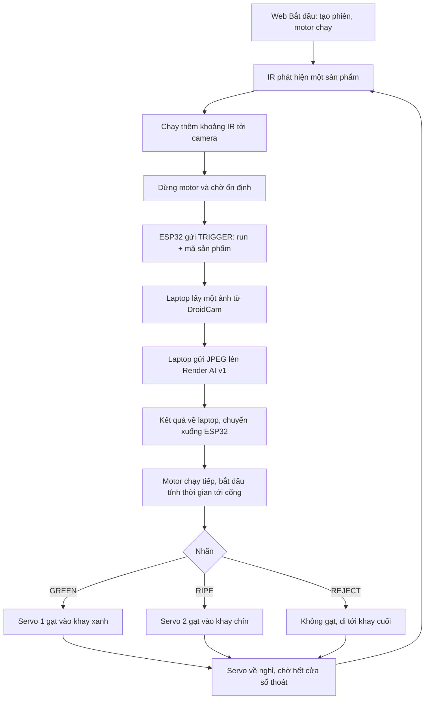

# Chu trình dừng để chụp và phân loại từng sản phẩm

Luồng đã chốt: **đưa sản phẩm → dừng tại camera → chờ ổn định → lấy ảnh →
chờ AI → chạy tiếp → đưa vào khay → sẵn sàng lượt tiếp theo**. Demo dùng quất,
nhưng đơn vị vận hành là sản phẩm và phiên. Một phiên có nhiều lượt; việc
dừng nội bộ để chụp không tạo phiên mới và không phải nút Tạm dừng trên web.

## Trình tự thực tế của phần mềm

1. Bridge kết nối USB và cloud nhưng motor vẫn dừng ở IDLE. Bấm Bắt đầu
   trên web mới tạo phiên và gửi START. Firmware áp dụng đầu ra rồi trả ACK.
2. Đặt **một** sản phẩm lên băng chuyền. IR phải nhả trước khi nhận cạnh
   phát hiện mới. Cảm biến được chống dội 20 ms theo cấu hình ban đầu.
3. IR hiện là cảm biến báo trước vị trí camera, nên firmware chạy thêm
   `irToCameraMs` rồi dừng. Nếu cơ khí đặt IR ngay tại điểm chụp, có thể
   hiệu chỉnh giá trị này về 0. Không đoán vị trí IR chỉ từ tên biến.
4. Sau khi tắt motor, firmware chờ `settleMs` cho quả ổn định rồi phát đúng
   một TRIGGER. Laptop mới lấy ảnh. Băng chuyền **tiếp tục dừng** trong WAIT_AI.
5. Với DroidCam, video tới laptop; bridge lấy khung mới, chuyển JPEG và chỉ
   gửi ảnh đó lên API. API trả GREEN/RIPE/REJECT về laptop, laptop gửi RESULT
   kèm run UUID và counter xuống ESP32. Không gửi video liên tục lên cloud.
6. Nhận kết quả đúng lượt mới bắt đầu DISPATCH và bật motor. Các mốc
   `cameraToGate1Ms` / `cameraToGate2Ms` được tính **từ lúc chạy tiếp**, không
   tính từ thời điểm IR hoặc từ lúc bắt đầu gọi AI. Thời gian AI thay đổi
   không được cộng vào thời gian di chuyển tới servo.
7. GREEN dùng servo 1, RIPE dùng servo 2. Mỗi servo có góc nghỉ, góc gạt và
   thời gian giữ riêng. REJECT giữ hai servo ở góc nghỉ để quả đi cuối băng.
8. Sau cửa sổ `max(gate1 travel + hold, gate2 travel + hold) + exitClearMs`,
   firmware tăng bộ đếm phần mềm và về RUNNING. Chỉ đưa sản phẩm tiếp theo
   sau bước này. Không có hàng đợi nhiều quả và chưa có cảm biến khay xác
   nhận quả thật đã ra hết.

Thời gian ban đầu chưa được hiệu chỉnh: IR → camera 300 ms, chờ ổn định
150 ms, camera → servo 1/2 là 1.200/2.500 ms, giữ mỗi servo 400 ms, thoát
bổ sung 500 ms. Cửa sổ dispatch là 3.400 ms kể từ lúc chạy tiếp. Không dùng
các giá trị này như chứng nhận cơ khí đã phù hợp.

## Cấu hình và hiệu chỉnh

Chỉ sửa [StationConfig.h](../esp32-controller/AutoSortSerial/StationConfig.h)
để đổi thời gian, góc, pin và PWM; không cần sửa logic `Controller.h` hoặc
bridge. Giữ file này cùng `Controller.h` và `.ino` khi nạp ESP32. Config không
hợp lệ bị chặn khi build sketch; state machine cũng không cho chạy nếu
nhận config không hợp lệ trong kiểm thử native.

Ghi kết quả vào [bảng hiệu chỉnh](STATION_CALIBRATION.md). Hiện chưa có thiết
bị, các mục thực nghiệm phải để **chưa đo/chưa kiểm tra**.

## Tạm dừng, kết thúc và lỗi

| Tình huống | Hành vi phần mềm |
|---|---|
| Tạm dừng trên web | Dừng motor, giữ trạng thái và thời gian đã di chuyển; không tạo phiên mới |
| AI trả về khi PAUSED | Giữ nhãn đúng lượt; chỉ Tiếp tục mới được chạy motor |
| Tiếp tục | Chạy phần thời gian còn lại; không tính thời gian tạm dừng vào hành trình |
| Kết thúc | Dừng motor, servo về góc nghỉ, bỏ kết quả tới muộn và đóng phiên sau ACK |
| Camera/gọi AI lỗi trên laptop | Quả hiện tại nhận REJECT dự phòng; không phải AI xác nhận thấy lỗi |
| Firmware chờ AI quá 30 s | Đi nhánh cuối với REJECT dự phòng, sau đó khóa lỗi để kiểm tra trạm |
| Mất heartbeat/ghi Serial dở/thiếu ACK | Dừng hoặc khóa theo watchdog/giao thức; không phát lại lệnh motor chưa rõ kết quả |
| Quả thứ hai trong lúc xử lý quả trước | Khóa SECOND_FRUIT, cần kiểm tra và reset |

Đóng tab hoặc đăng xuất không tự dừng trạm. Sau Kết thúc giữa lượt, lấy quả
đang dở trước khi Bắt đầu lại. Thay đổi watchdog AI phải đồng bộ thời hạn job
của bridge: mặc định bridge tối đa 25 s, firmware 30 s, chừa biên cho Serial.
Giữ các mốc watchdog hiện có trong lúc hiệu chỉnh cơ khí.

## Kiểm chứng khi chưa có thiết bị

- `tests/firmware_controller_test.cpp` chạy chính Controller của ESP32:
  motor tắt trước TRIGGER, chỉ một TRIGGER, đứng yên chờ AI, lấy mốc gate
  sau RESULT, từng góc/hold tùy chỉnh, cả ba nhãn và về sẵn sàng sau thoát.
- Có test IR tại camera (`irToCameraMs=0`), pause trong chờ ổn định, pause
  trong gate/WAIT_AI, kết quả cũ, timeout, overflow timer và cấu hình sai.
- Test Python và E2E kiểm tra video thật → JPEG → Java/ONNX/PostgreSQL
  localhost → kết quả có run/counter → Serial fixture, cùng START/PAUSE/
  RESUME/STOP. Xem [DroidCam và thử offline](DROIDCAM_SETUP.md).

Các test này kiểm chứng logic, không xác nhận chiều quay motor, khoảng dừng,
góc cơ khí hay quả đã được gạt đúng khay. Việc nghiệm thu vật lý vẫn chờ
điện thoại, ESP32, cảm biến, motor/driver và servo của nhóm.
